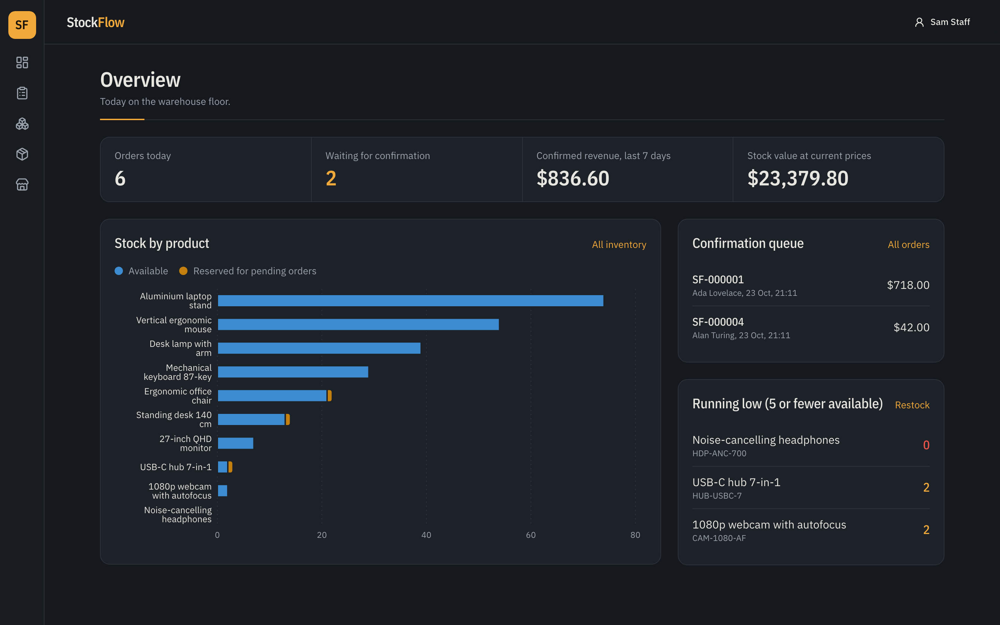
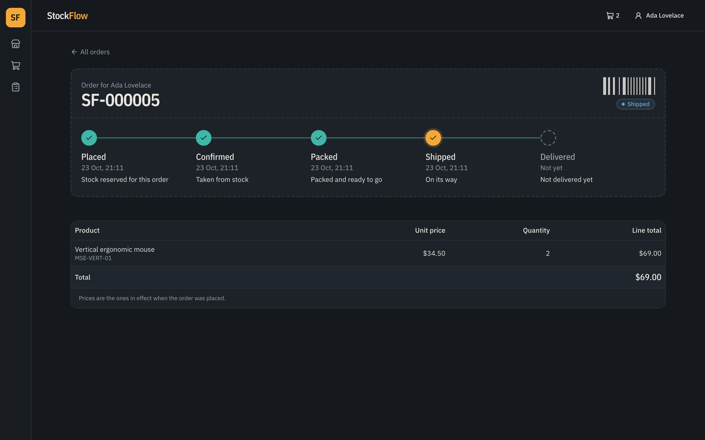
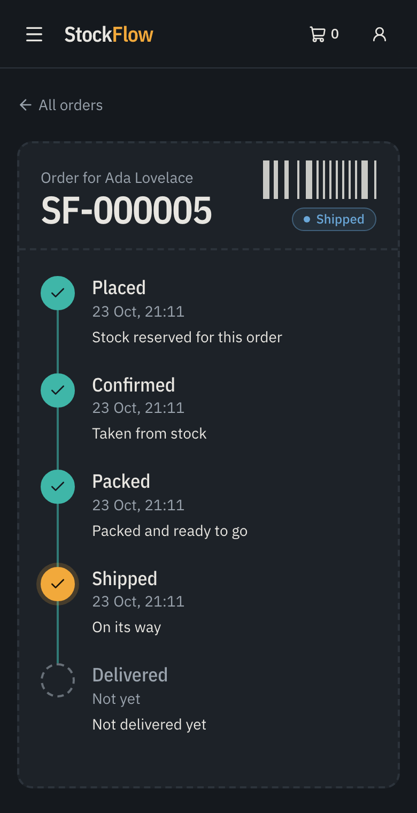
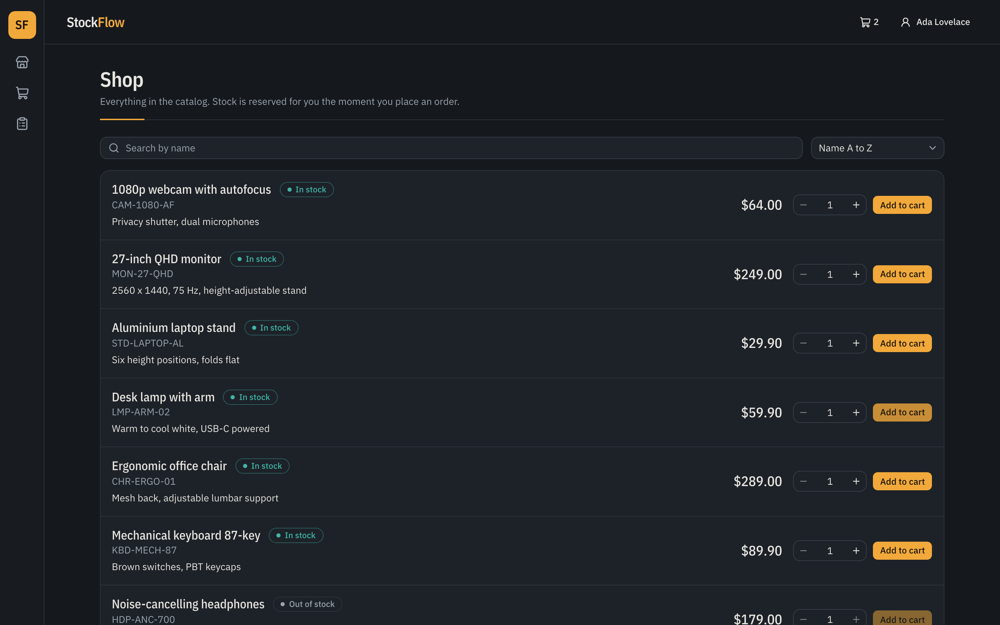
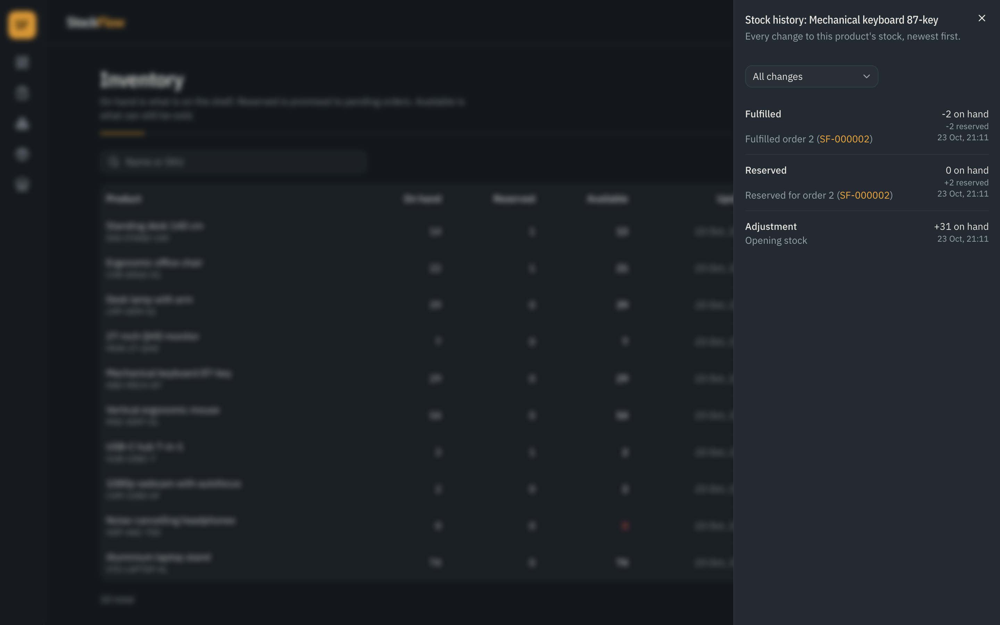
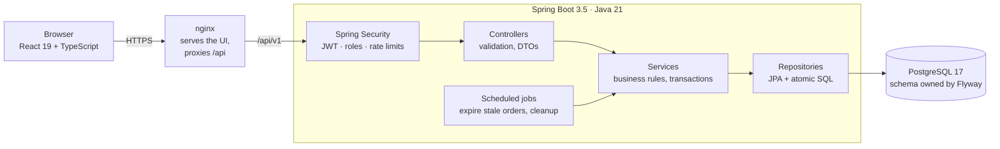
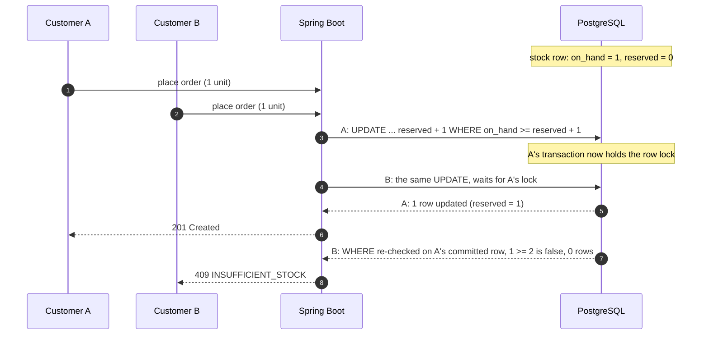
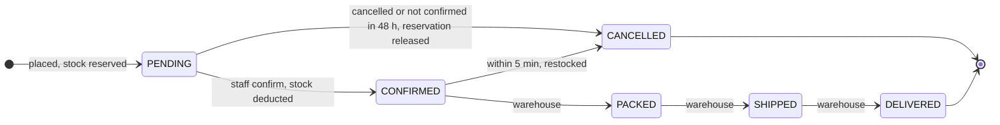
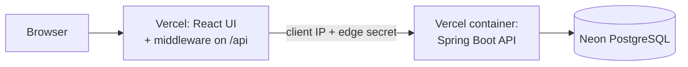
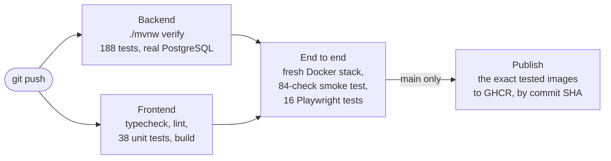

# StockFlow

**Order and inventory management for a small business: a Spring Boot API and a React UI that never sell stock that isn't there, even when many customers order the last unit at the same moment.**

## Live demo

### 👉 [stockflow-shop.vercel.app](https://stockflow-shop.vercel.app)

Sign in with any demo account; each role sees a different app:

| Role | Email | Password | What to try |
|---|---|---|---|
| Customer | `ada@example.com` | `customer-password-123` | Shop, add to cart, check out, track the order |
| Staff | `staff@stockflow.local` | `staff-password-123` | Overview, confirm orders, change stock, products |
| Warehouse | `warehouse@stockflow.local` | `warehouse-password-123` | Pack, ship and deliver confirmed orders |

> [!NOTE]
> Free hosting: the API goes to sleep when nobody uses it, so the **first request after a few quiet minutes
> takes about 20 seconds** while Java starts. After that it answers in about 0.3 s. Checkout ships within
> Germany only, so use any German address (e.g. Musterstraße 12a, 10115 Berlin). The demo data is public:
> please don't enter real personal details.

---

[](https://github.com/bossshhh/stockflow/actions/workflows/ci.yml)


[](LICENSE)



[Highlights](#highlights) ·
[Screenshots](#screenshots) ·
[Architecture](#architecture) ·
[How overselling is prevented](#how-overselling-is-prevented) ·
[Order lifecycle](#order-lifecycle) ·
[Getting started](#getting-started) ·
[Deployment](#deployment) ·
[Testing](#testing) ·
[API](#api) ·
[Engineering decisions](#engineering-decisions) ·
[Roadmap](#roadmap) ·
[Author](#author)

---

## Highlights

- **No overselling under concurrency.** Every stock change is one atomic conditional `UPDATE` whose
  `WHERE` clause *is* the stock invariant. There is no read-check-write in Java. Ten simultaneous orders
  for the last unit: exactly one wins, proven by a test and by a live race of 10 parallel HTTP requests.
- **Deadlock-free multi-item orders.** Rows are always locked in one global order (order row, then stock
  rows by ascending product id). A test sends `[A, B]` and `[B, A]` orders from 20 threads; without the
  sorting, PostgreSQL reports `deadlock detected`.
- **Safe retries.** `POST /orders` accepts an `Idempotency-Key`. A retried request (lost response, double
  submit) returns the order already placed instead of placing it twice. The UI sends one key per cart.
- **A full order lifecycle with stock side effects.** Reserve on create, deduct on confirm, release or
  restock on cancel, then pack, ship and deliver. Every status change records who and when, and drives
  the customer's tracking label.
- **Abandoned orders cannot hold stock forever.** A scheduled job cancels PENDING orders that nobody
  confirmed in time and releases their stock, safely, even with several instances running it at once.
- **Security in depth.** Short-lived JWTs that can still be revoked instantly (disable an account or "sign
  out everywhere" and its tokens fail on the next request), rotating refresh tokens in an HttpOnly cookie
  with theft detection, BCrypt, role-based access plus ownership checks, rate-limited login and registration, and a
  strict Content Security Policy.
- **Resilient under contention.** A 3-second lock timeout on every database connection turns "wait
  forever" into a clean, retryable `409 CONCURRENT_UPDATE`.
- **Tested end to end.** 188 backend tests (unit, integration against real PostgreSQL, concurrency,
  security), 38 frontend unit tests and 16 browser tests. CI starts the whole Docker stack from scratch on
  every push and runs the browser tests and an 84-check API smoke test against it.

## Screenshots

| Customer: order tracking | On a phone |
|---|---|
|  |  |

| Customer: shop | Staff: stock history (audit trail) |
|---|---|
|  |  |

## Architecture



- **One origin for the browser.** nginx serves the built UI and forwards `/api` to Spring Boot, so there
  is no CORS in the normal flow and the `SameSite=Strict` refresh cookie just works.
- **Thin controllers, rules in services, invariants in the database.** Services own the transactions;
  every cross-request rule (unique SKUs, no negative or oversold stock) is also a database constraint.
- **Package by feature**, with dependencies pointing one way only:

```
com.stockflow
├── product/     products, unique SKUs
├── inventory/   stock levels, atomic stock changes, movement history, reports, public catalog
├── order/       order lifecycle, idempotency keys, search, reports, housekeeping
├── user/        accounts and roles
├── security/    Spring Security, JWT, refresh tokens, rate limiting
├── common/      error handling, paging
└── config/      clock, scheduling, JDBC, OpenAPI

order → inventory → product            security → user
```

## How overselling is prevented

Two customers try to buy the last unit at the same moment. Both requests reach the database; neither
checks stock in Java first.



The check and the change are **one statement**, so there is no window between "is there stock?" and
"take it" for another request to slip into:

```sql
UPDATE inventory
SET    on_hand  = on_hand  + :onHandChange,
       reserved = reserved + :reservedChange
WHERE  product_id = :productId
  AND  reserved + :reservedChange >= 0                        -- never release more than is reserved
  AND  on_hand + :onHandChange >= reserved + :reservedChange  -- never promise more than is on the shelf
```

Reserve, release, fulfil, restock and manual adjustments are all this one statement with different
deltas. "0 rows updated" means the change would break an invariant, and the request fails cleanly.
A `CHECK` constraint backs it up, and every change writes a stock-movement row in the same transaction.

## Order lifecycle



| | Customer | Warehouse | Staff | Admin |
|---|:---:|:---:|:---:|:---:|
| Shop and place orders | ✅ | | | |
| See orders | own | all | all | all |
| Confirm | | | ✅ | ✅ |
| Pack, ship, deliver | | ✅ | ✅ | ✅ |
| Cancel (before packing) | own | | ✅ | ✅ |
| Products, stock changes, reports | | read stock | ✅ | ✅ |
| Manage accounts | | | | ✅ |

## Getting started

Requirements: **Docker**. Node.js 24+ only to develop the UI; JDK 21 only to run the backend outside Docker.

```bash
cp .env.example .env           # set DB_PASSWORD, JWT_SECRET (openssl rand -base64 32), ADMIN_EMAIL/PASSWORD
docker compose up -d --build   # PostgreSQL + API + web UI
scripts/seed-demo.sh           # optional: demo products, orders and accounts
```

| | URL |
|---|---|
| Web UI | http://localhost:3000 |
| Swagger UI | http://localhost:8080/swagger-ui.html (log in via `POST /api/v1/auth/login`, then **Authorize**) |
| Health | http://localhost:8081/actuator/health |

**Demo accounts** (local only, created by the seed script):

| Role | Email | Password |
|---|---|---|
| Customer | `ada@example.com` | `customer-password-123` |
| Warehouse | `warehouse@stockflow.local` | `warehouse-password-123` |
| Staff | `staff@stockflow.local` | `staff-password-123` |
| Admin | from `ADMIN_EMAIL` in `.env` | from `ADMIN_PASSWORD` in `.env` |

**Development mode:**

```bash
docker compose up -d db                     # database only
./mvnw spring-boot:run                      # API from Maven or your IDE
cd frontend && npm install && npm run dev   # UI with hot reload on http://localhost:5173
```

## Deployment

The live demo runs entirely on free tiers, deployed by CI only after every test has passed:



- **One origin.** The UI's Vercel middleware forwards `/api/*` to the API, so the browser only ever talks to
  one site and the `SameSite=Strict` refresh cookie keeps working.
- **The API only answers the front end.** The middleware adds a shared secret and the visitor's IP; the API
  refuses every request without the secret (403), so nobody can call it directly with a forged client IP
  to get around the login rate limits. Locally and in Docker the check is off.
- **What runs is what was tested.** After the e2e job passes, CI pushes the tested image to GHCR and deploys
  the API from that exact digest (`FROM ghcr.io/...@sha256:...`), then the UI.
- A self-hosted option (Docker Compose behind Caddy with HTTPS) is in [`deploy/`](deploy/).

## Testing



Images reach the registry only from `main`, only after every test passed, and only the images the e2e job
tested (saved by image ID and verified unchanged, never rebuilt). The publish job is the only one with
permission to write packages, and it runs no project code.

| Level | Tool | What it proves |
|---|---|---|
| Unit | JUnit 5, Mockito, Vitest | Business rules in isolation: the order state machine, the exact 5-minute cancel boundary, token refresh single-flight |
| Integration | Spring Boot Test + **Testcontainers** (real PostgreSQL) | HTTP contracts, transactions, SQL, security rules, error shapes |
| Concurrency | Real threads against real PostgreSQL | No overselling, no deadlocks, one order per idempotency key, job runs racing staff actions |
| Smoke | `scripts/smoke-test.sh` (bash, curl) | The running production-profile stack, every role, over real HTTP |
| Browser | Playwright (Chromium) | Every role's journey in the real UI, phone layout, no browser errors |

```bash
./mvnw verify                                   # backend (Docker must be running)
cd frontend && npm test                         # frontend unit tests
scripts/smoke-test.sh                           # against a running stack
cd frontend && npx playwright install chromium && npm run e2e
```

**Why not H2?** It does not reproduce PostgreSQL's locking, so the concurrency tests would prove nothing.

## API

| Area | Endpoints | Who |
|---|---|---|
| Auth | `POST /api/v1/auth/register`, `/login`, `/refresh`, `/logout`, `/logout-all` (sign out everywhere), `GET /api/v1/auth/me` | public / signed in |
| Catalog | `GET /api/v1/catalog?q=`, `GET /api/v1/catalog/{id}` (active products, `inStock` flag, no counts) | public |
| Products | `GET/POST /api/v1/products`, `GET/PUT/DELETE /api/v1/products/{id}` | read: all; write: staff |
| Inventory | `GET /api/v1/inventory?q=`, `GET /{productId}`, `POST /{productId}/adjustments`, `GET /{productId}/movements`, `GET /low-stock`, `GET /valuation` | staff (warehouse: read) |
| Orders | `POST /api/v1/orders` (optional `Idempotency-Key`), `GET /api/v1/orders` (search), `GET /{id}`, `POST /{id}/confirm`, `POST /{id}/cancel`, `GET /summary` | customers: own; staff: all |
| Fulfilment | `POST /api/v1/orders/{id}/pack`, `/ship`, `/deliver` | warehouse, staff |
| Admin | `POST /api/v1/admin/users`, `POST /api/v1/admin/users/{id}/disable`, `/enable` | admin |

The full, always-current contract is in Swagger UI; the frontend's TypeScript client is generated from it.
Every error has the same shape, with a stable machine-readable `code`:

```json
{ "timestamp": "...", "status": 409, "code": "INSUFFICIENT_STOCK",
  "message": "Not enough stock available for SKU PEAR", "path": "/api/v1/orders", "fieldErrors": [] }
```

## Engineering decisions

| Decision | Why |
|---|---|
| Conditional `UPDATE ... WHERE <invariant>` for every stock change | Check and change in one atomic statement; no race window |
| Database constraints back every invariant (`UNIQUE`, `CHECK reserved <= on_hand`) | Defence in depth; Java checks only produce nicer errors |
| `SELECT ... FOR UPDATE` on the order for confirm, cancel and fulfilment | Two simultaneous actions on one order are serialized; the second gets a clean 409 |
| Idempotency key claimed with `INSERT ... ON CONFLICT` *before* any stock is touched | Concurrent duplicates wait on a tiny index and replay the result, instead of queueing on hot stock rows |
| Price, SKU and name snapshotted on order items | Later product edits never rewrite past orders |
| Shipping address snapshotted on the order, validated to DHL's field limits | A parcel goes where it was ordered to; an address accepted at checkout is never rejected by the carrier at ship time |
| `lock_timeout` (3 s) on every connection; lock conflicts → 409 + `Retry-After` | One stuck transaction can no longer freeze the API |
| Token buckets for failed logins (per email and per IP) and registrations; client IP from trusted proxies only | Stops password guessing and credential stuffing without slowing real users; a fake `X-Forwarded-For` cannot dodge it |
| Housekeeping re-checks each order under its row lock instead of a distributed lock | Correct even when two instances run the job at once; one dependency and one table fewer |
| JWT: 15-minute access tokens with only `userId` + `role`; refresh tokens rotate and are stored as hashes | Stateless auth; a leaked database or a replayed token does not give lasting access |
| A per-user token version in every JWT, checked on each request through a 10 s cache | Disabling an account or signing out everywhere takes effect at once instead of within 15 minutes; a counter, because JWT issue times only have whole-second precision |
| CI publishes the exact images the e2e job tested, from a separate job that runs no project code | What gets deployed is what was tested; a compromised dependency cannot push images |
| On the free deployment, the API trusts the client IP only next to a shared edge secret from the Vercel middleware | The API's own URL is public; without the secret a forged IP header would bypass the per-IP login limits |
| Testcontainers instead of H2 | H2 does not reproduce PostgreSQL locking |
| Flyway owns the schema, `ddl-auto: validate` | Versioned, reviewable schema changes; Hibernate never alters the database |

## Roadmap

**Done**

- [x] Products, inventory, orders, search and reports
- [x] Security: JWT, refresh-token rotation, roles, ownership
- [x] Web UI: shop, cart, order tracking, staff overview, orders, inventory, products, team
- [x] Fulfilment tracking (packed, shipped, delivered) and the warehouse role
- [x] CI with a full Docker stack, Playwright browser tests and an API smoke test
- [x] Idempotent order placement, lock timeouts, login and registration rate limiting
- [x] Housekeeping: expire stale pending orders, delete expired tokens and idempotency keys
- [x] CI deploy gate: only images that passed every test are published, by commit SHA
- [x] Instant access-token revocation: disable accounts, sign out everywhere
- [x] Public deployment with HTTPS on free tiers (Vercel + Neon), deployed only by CI after every test passes

**Next**

- [ ] Load test with measured numbers, observability (request ids, metrics, dashboards)
- [ ] Audit trail for every stock change, account management
- [ ] Carrier integration (DHL / UPS tracking numbers), multiple warehouses

## Author

**Bashar Soufan**, software engineer

- GitHub: [@bossshhh](https://github.com/bossshhh)

Questions or feedback about the design are welcome: open an issue.

## License

[MIT](LICENSE) © 2026 Bashar Soufan

---

<sub>Screenshots are generated from demo data with `npm run screenshots` (in `frontend/`) against a stack seeded by `scripts/seed-demo.sh`.</sub>
